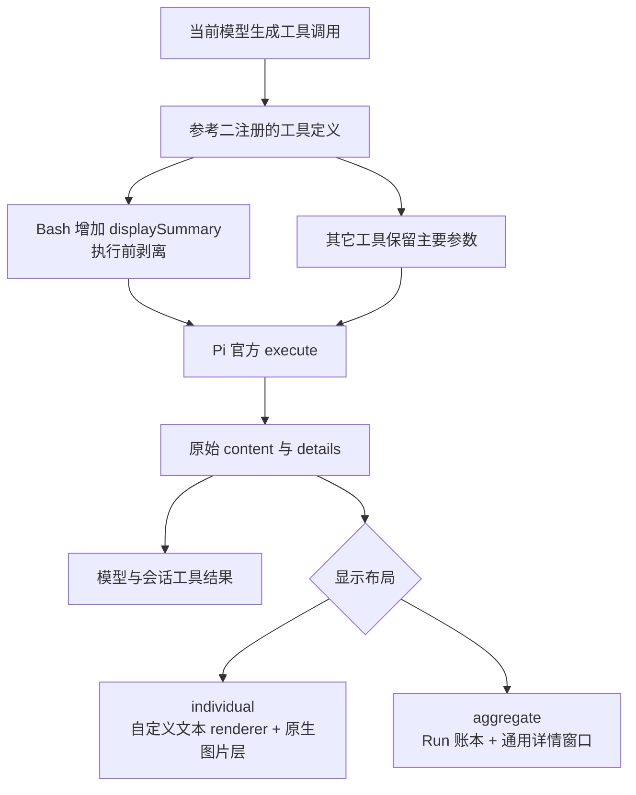

# 参考二调查：pi-tool-display-intent

## 对象与版本

- 项目一：`../pi-tidy-tools`，包版本 0.2.2。按当前工作文件调查，`tidy-tools.ts` 存在用户未提交修改，未改动它。
- 参考二：[zhcsyncer/pi-extensions/packages/pi-tool-display-intent](https://github.com/zhcsyncer/pi-extensions/tree/main/packages/pi-tool-display-intent)，包版本 0.10.1。
- 来源提交：`f48a91b8366174f2ece5d393e280641be87fbb70`。
- 本地源码：`reference-2/packages/pi-tool-display-intent/`。
- 下载方式：`gh repo clone --depth 1` 超时后，改用 GitHub API 下载该提交的源码归档。保留整个 monorepo，以便查看共享文档。已将失败克隆留下的 `.git` 元数据移入废纸篓；这是源码快照，不是可直接 git pull 的完整克隆。
- 本机 Pi：`@earendil-works/pi-coding-agent` 0.99.1。参考二开发依赖锁定 0.86.1，peer 范围声明 `>=0.80.0 <1`。

## 结论

参考二以显示功能为主，但影响范围超过工具的 `renderCall` / `renderResult`：它重新注册内置工具、修改 Bash 参数 schema 和提示词、额外读取文件制作 diff、修补原生 UI 类，以及在 aggregate 模式下重新组织整段工具活动的显示。

内置文件和命令操作主要委托 Pi 官方实现。没有在已检查代码中发现为生成意图另发模型请求，或由显示逻辑主动压缩模型收到的工具正文。隐藏、摘要、预览主要作用于用户界面，不等于减少模型上下文。

建议先单独试用 individual + summary；若要求 aggregate 里直接看到图片、保留项目一展开体验或完全不改模型 schema，需要适配。

## 执行与显示关系



### 重新注册的工具

默认接管 `read`、`grep`、`find`、`ls`、`bash`、`edit`、`write`。按 cwd 缓存官方实现，并传递取消信号和 onUpdate。

Bash 从用户级 Pi settings 读取 `shellPath`、`shellCommandPrefix`。这里只读用户级文件，没有看到合并项目级 Bash 配置的实现。

Write 执行前会读取旧文件，用于 individual 前后 diff；Edit/Write 参数准备完整后，也可能额外读文件生成执行前预览。它们不是额外写入操作。

### 意图字段

自动要求意图的内置工具只有 Bash。`displaySummary` 是必填字符串，默认最大 96 字符，并增加 prompt guideline。它由当前模型在同一次工具调用中填写，无额外推理请求，但 schema、提示词和生成的意图文字都会占用 token。

执行时字段被剥离，不会成为 shell 参数。`prepareArguments` 对缺失字段有确定性兜底。第三方工具可以通过合作 API 自愿使用该字段。

### 超出工具行的 UI 修改

即使 individual 模式也会修改用户消息显示和 Container 的 spacer 行为。aggregate 模式还修补 ToolExecutionComponent、全局展开、鼠标、视口、custom message 等逻辑，显示 Run 统计、旁白、steer、耗时、token 和可选上下文增长。

这些功能依赖 Pi 的原生组件及其内部行为，比项目一仅包装几种工具的适配范围更大。

## Read 图片：必须区分两个问题

### 模型能否收到图片

参考二内置 Read 返回官方 Read 的结果，没有在 execute 中只取文本。实际读取项目中的 PNG 后，结果包含一个 text block 和一个 `image/png` image block，图片数据长度 28248。

这证明扩展执行结果保留了图片，不等于当前模型一定支持视觉；模型与供应商对图片的支持仍由 Pi 处理。

### 用户能否在终端看到图片

| 场景 | 从代码确认的行为 |
|---|---|
| individual | 自定义 Read renderer 只处理文本；Pi ToolExecutionComponent 独立追加 image components，包括 `renderShell: self` 分支。因此原生图片路径仍保留。实际显示依赖终端图片协议及 Pi 的 showImages 设置。 |
| individual + compact | Read 文本正文隐藏，但图片层没有被该 hidden 分支清除。 |
| aggregate | 工具行的 render 被 Run 账本替代，普通成员不调用原生图片渲染；Ctrl+O 展开仍是账本工具行。 |
| aggregate 详情窗口 | 显示附件类型、MIME 等文字信息，明确不展示非文本载荷；没有图片像素预览。 |
| aggregate + read passthrough | 从源码看，可让 read 走原生 render，保留图片路径；代价是所有 read 都透传。需要实际 fullscreen 验证。 |

图片聚合行为还有上游测试保护：`aggregate-activity.test.ts` 的 `image results stay in the Run ledger like ordinary output` 明确断言不恢复原生图片工具行。

## 默认行为与容易误解的边界

默认值来自 `src/types.ts`，不能用 `config.example.json` 代替默认值：

- 布局：individual；工具样式：Claude；结果模式：compact。
- compact：Read、搜索、MCP 正文隐藏；Bash 预览 8 行。
- summary：Read 显示行数、搜索显示数量、MCP/Bash 显示摘要；Ctrl+O 可展开文本。
- preview：显示文本预览。
- expandedRows 默认 4000，展开仍可能受行数限制。即便配置为 0，源码仍保留 MAX_PREVIEW_LAYOUT_ROWS 布局保护。
- diff 默认自动布局、折叠最多 24 行；Write 固定单栏。
- truncationHints 默认关闭。显示层展开不能恢复官方工具已经截断掉的内容。
- aggregate 的 Write 详情把本次写入内容标为新增，不声称是覆盖前后的净差异。
- 配置写入 Pi agent directory 下的 `extension-data/pi-tool-display-intent/config.json`，通常在 `~/.pi/agent/`。可能迁移旧配置；布局、工具归属和 schema 改动需要 reload。

### 已复现的错误显示问题

调用 Read renderer，传入 ENOENT 文本和 `context.isError: true`：

| Read 模式 | 实际渲染 |
|---|---|
| hidden（默认 compact） | 空结果行 |
| summary | `loaded 1 line • Ctrl+O to expand` |
| preview | 原始 ENOENT 文字 |

原因：`renderReadDisplayResult` 不检查错误状态，hidden 分支直接返回空文本，summary 分支把错误当普通文本统计。搜索工具的 renderer 也没有单独错误分支，存在同类风险，尚未针对搜索错误执行独立探针。

Bash、Edit、Write、MCP 有各自错误处理；Bash 的部分输出走实时预览。没有完整跑取消、超时、所有工具错误或真实交互端到端检查。

### 与当前 Pi 的执行契约差异

参考二调用 `create*Tool().execute()` 时仅转发前四个参数，没有把 ctx 传给官方工具。

本机 Pi 0.99.1 的 Read 明确使用 `ctx.model.inputLimits.images.resize` 和模型视觉能力信息。这些模型相关信息在参考二的 Read 委托路径中缺失。cwd 已用于创建工具，所以普通文件定位通常仍有效；模型相关图片设置需要适配。

参考二重建工具定义时，也没有完整保留当前官方工具的 `constrainedSampling` 等元数据。已检查当前 Read 定义含有该字段，而参考二的基础定义未复制它。普通参数和成功执行已验证；这不代表完整工具契约保持一致。

## 项目一与参考二

| 维度 | 项目一 tidy tools 当前文件 | 参考二 |
|---|---|---|
| 工具范围 | Bash/Edit/Write | 7 个内置工具，另有 custom/MCP 装饰与聚合 |
| 模型额外字段 | 无 displaySummary | Bash 要求 displaySummary |
| 收起显示 | 很短：命令、首行输出、计数或完成状态 | 隐藏/摘要/预览，多种 diff 展示 |
| 展开控制 | Ctrl+Alt+B/E/W、fullscreen 单行点击、Markdown 模式 | Ctrl+O；aggregate 可局部展开及点击详情 |
| Read 图片 | 不接管 Read | individual 保留原生路径；aggregate 不直接显示像素 |
| 配置 | 展开模式不跨重启持久化 | 配置持久化并提供 /tools 面板 |
| 原生 UI 影响 | MouseRegion、工具 renderer、按键序列归一化 | 用户消息与多个原生组件 prototype patch |

不要直接同时启用后假设两者叠加。二者都注册 Bash/Edit/Write。参考二有工具归属检测，尝试跳过已由其它扩展拥有的工具，但生效仍依赖加载阶段能否看到 sourceInfo 与加载顺序。

而且在 aggregate 下，工具未被参考二重新注册，不代表它不会被账本收纳；透传名单才明确保留原生 renderer。

本次会话提供的工具包括 fffind、ffgrep。它们不是参考二默认重注册的 grep/find。individual 下需要显式 custom 配置或 adapter 才能获得对应展示；aggregate 会收纳 generic custom tool，但未必理解其特定参数和结果语义。

## 建议的试用与适配顺序

1. 首次试用仅加载参考二子包，不加载整个 pi-extensions 根包，避免一并启用其它扩展。
2. 暂时不加载 tidy tools，使用 individual + summary，观察 Bash 意图和 diff 是否满足需求。
3. 先修 Read/搜索错误显示，确保错误在 hidden 模式仍可见、summary 不报告成功式统计。
4. 补齐 ctx 转发及当前 Pi 必要工具元数据，再检查模型图片缩放和 shell 配置。
5. 若采用 aggregate 且需要看到图片，比较 read 全量 passthrough 与仅图片结果走原生路径。前者可以先用配置尝试，后者需要代码改动。
6. 若希望保留项目一体验，先确定每个工具由谁拥有；再把需要的展开方式作为明确适配项，避免两个同名工具实现争抢。

尚未安装、未修改用户配置、未修改参考二源码或项目一，没有启动额外模型调用。

## 验证记录与复现

现有测试通过 Pi 自带 jiti 加载，映射到本机已安装的 Pi 0.99.1，不额外安装依赖。使用独立临时 PI_CODING_AGENT_DIR，未读取或迁移真实用户扩展配置。

执行了四个测试文件：display-summary、detail-viewer-model、aggregate-activity、index-integration。**114 项通过，0 项失败**。

另外做了实际 PNG Read、Read 错误显示、Bash schema、当前 Edit 多 block schema 探针。首次合成小 PNG 未产生图片，改用仓库有效 PNG 后通过；不能把前一次失败视为扩展丢弃正常图片的证据。

```bash
node checks/run-targeted-tests.mjs \
  "$PWD/reference-2/packages/pi-tool-display-intent/tests/display-summary.test.ts" \
  "$PWD/reference-2/packages/pi-tool-display-intent/tests/detail-viewer-model.test.ts" \
  "$PWD/reference-2/packages/pi-tool-display-intent/tests/aggregate-activity.test.ts" \
  "$PWD/reference-2/packages/pi-tool-display-intent/tests/index-integration.test.ts"
node checks/probe-behavior.mjs "$PWD/reference-2/packages/pi-tool-display-intent"
```

脚本中的 host 路径指向本机 Pi 安装位置，在其它机器运行需修改。结果保存在 `checks/targeted-tests.log` 和 `checks/probe-behavior.log`。

未执行：全量上游测试、tsc、真实终端图片显示、fullscreen 鼠标/滚动/reload E2E、RPC/print 会话、与 tidy tools 同时加载。通过 114 项针对性测试不能替代这些检查。

## 主要代码依据

- `src/index.ts`：注册入口、/tools、配置更新和 reload。
- `src/tool-overrides.ts`：内置工具委托、Write 前读、Read/搜索错误分支缺失、工具归属、MCP/custom 装饰。
- `src/display-summary.js`：schema 和 prompt guideline、参数剥离及 fallback。
- `src/aggregate-activity.ts`：原生工具 render 替换、passthrough、事件投影。
- `src/detail-viewer-model.ts`：附件文字信息、载荷省略、详情与 diff。
- `src/user-message-box-native.ts`：用户消息和 Container patch。
- `src/types.ts`、`src/presets.ts`：真实默认值与结果模式。
- 本机 Pi `dist/modes/interactive/components/tool-execution.js`：原生图片独立追加。
- 本机 Pi `dist/core/tools/read.js`、`tool-definition-wrapper.js`：模型图片信息和 ctx 转发契约。
